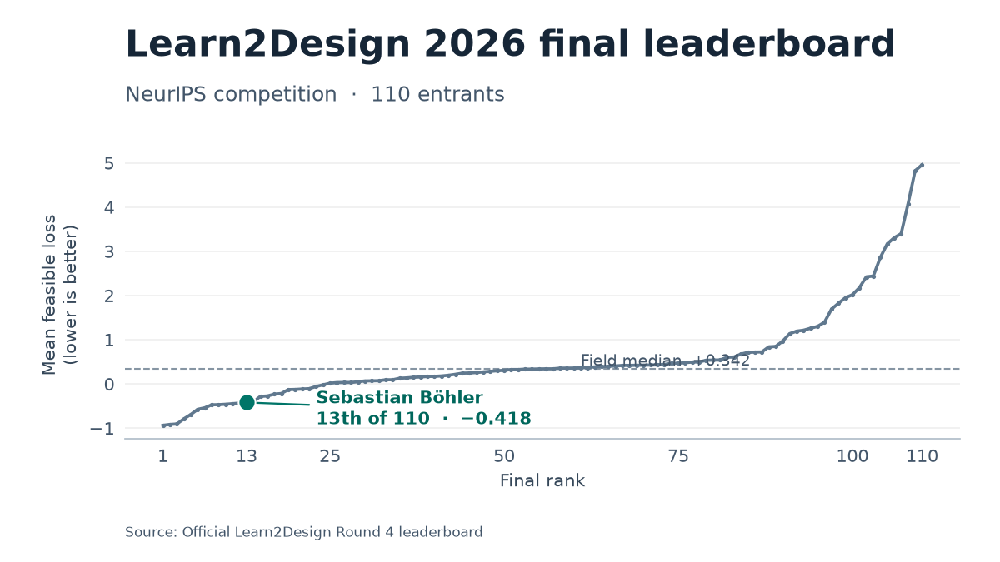

# Sebastian Böhler

I’m an M.Sc. Computer Science student and research assistant at the University of Tübingen. I work on scientific optimization, simulation, and machine learning. I also run [Sunderlabs](https://sunderlabs.com), where I work on learned flight control and speech models.

[Website](https://sebastian-boehler.com) · [CV (PDF)](public/sebastian_boehler_cv.pdf) · [LinkedIn](https://www.linkedin.com/in/sebastian-boehler/)

## Selected research

- **Learn2Design 2026** — Optimized gravitational-wave detector layouts and built a faster JAX simulator backend. **13th of 110** in the final round. A follow-up paper is in progress. [Leaderboard](https://github.com/artificial-scientist-lab/Learn2Design-2026/blob/main/competition_data/round4/leaderboard.csv)
- **Fusion Equilibrium Challenge** — Reconstructed magnetic equilibria in MAST with a free-boundary Grad–Shafranov solver on CPU. **11th in cross-machine generalization** and **18th on DIII-D** in the organizers’ final results. [Code and write-up](https://github.com/SebastianBoehler/fusion-equilibrium-challenge) · [Results](https://fusion-equilibrium-challenge.sophelio.io/results/)
- **EEG/EMG Foundation Challenge, Track 2** — Combined an EEG model ensemble with label-free session adaptation. **84.4% cell-mean balanced accuracy** in the sealed final, provisional pending audit. [Leaderboard](https://neural-interfaces26.github.io/leaderboard.html#track-2)

*Learn2Design final round. My entry scored −0.418 mean feasible loss, where lower is better.*

## Open-source software

- **Prediction Market Research Lab** — Collects market snapshots from Polymarket and Kalshi and supports pricing analysis, strategy experiments, and outcome verification. [Research Lab](https://github.com/SebastianBoehler/prediction-market-research-lab)
- **C++ market clients** — [Polymarket](https://github.com/SebastianBoehler/polymarket-cpp-client) · [Limitless](https://github.com/SebastianBoehler/limitless-cpp-client) · [Opinion.trade](https://github.com/SebastianBoehler/opinion-cpp-client)
- **Agent skills** — Workflows for engineering, research, and coordination. [Skills](skills/README.md)

## Publication

**QLoRA Fine-Tuning for Next User Turn Prediction and Multi-Step Dialogue Rollouts.** IEEE ICETSIS 2026, pp. 1548–1555. [DOI](https://doi.org/10.1109/ICETSIS68266.2026.11549360)
