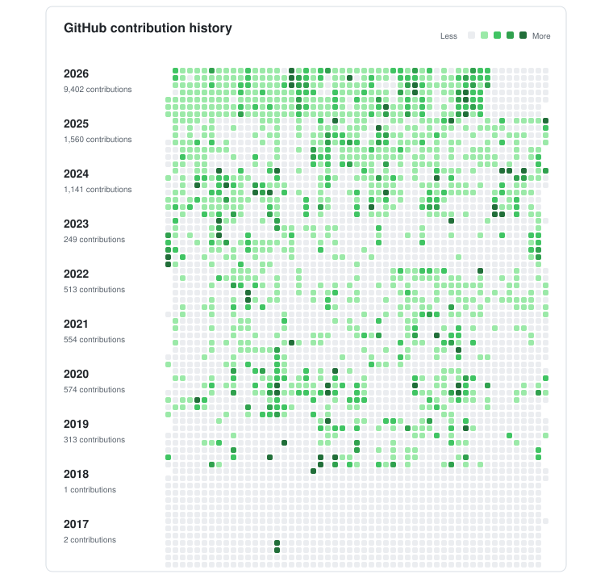
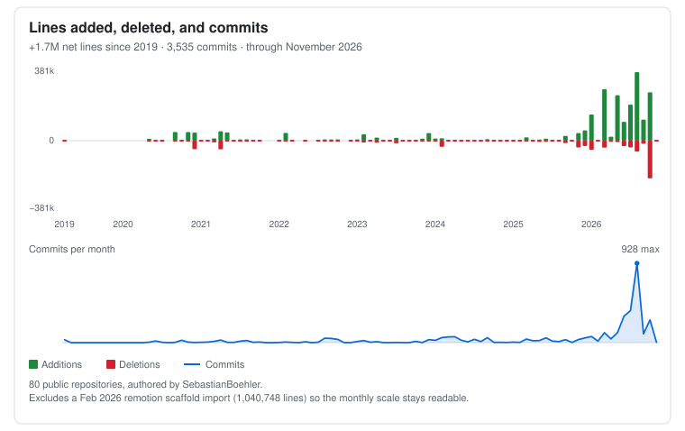

# Sebastian Böhler

M.Sc. Computer Science student at the [University of Tübingen](https://uni-tuebingen.de) and founder of [Sunderlabs](https://sunderlabs.com). I work on optimization and simulation for scientific problems, learned control for small robots, and speech models.

[sebastian-boehler.com](https://sebastian-boehler.com) · [CV (PDF)](public/sebastian_boehler_cv.pdf) · at NeurIPS 2026 in Sydney, 11–12 December

## Now

- **[Fusion Equilibrium Challenge](https://fusion-equilibrium-challenge.sophelio.io/)** (NeurIPS 2026 competition) — final results: 16th of 46 on zero-shot transfer to MAST, 19th of 58 on DIII-D. For MAST I solved the free-boundary Grad–Shafranov equation for each shot on CPU, without machine learning. [Code and write-up](https://github.com/SebastianBoehler/fusion-equilibrium-challenge).
- **[Learn2Design 2026](https://www.learn2design2026.com/)** (NeurIPS 2026 competition) — 13th of 110 on the [official final-round leaderboard](https://github.com/artificial-scientist-lab/Learn2Design-2026/blob/main/competition_data/round4/leaderboard.csv). Gravitational-wave detector design in JAX; built `differometor-fast`, a faster simulator backend. Technical report submitted; winners are announced on 11 December. A follow-up paper is in progress.
- **[EEG/EMG Foundation Challenge 2026](https://neural-interfaces26.github.io/)**, Track 2 (NeurIPS 2026 Brain & Body Workshop) — decoding cognitive tasks from EEG across sessions and participants. The sealed final phase runs 5–21 November.
- **[Sunderlabs](https://sunderlabs.com)** — learned flight control for the Crazyflie nano-quadcopter (simulation so far), and a German full-duplex voice agent on a EuroHPC AI Factory compute award.
- **Research Assistant** at the Hector Research Institute of Education Sciences and Psychology, Tübingen.

## Research

- **[QLoRA Fine-Tuning for Next User Turn Prediction and Multi-Step Dialogue Rollouts](https://doi.org/10.1109/ICETSIS68266.2026.11549360)** — IEEE ICETSIS 2026, pp. 1548–1555. DOI: [10.1109/ICETSIS68266.2026.11549360](https://doi.org/10.1109/ICETSIS68266.2026.11549360).
- **EuroHPC AI Factory compute** — two awards of 5,000 GPU-hours each on Leonardo (CINECA): the German voice agent, and follow-up research on Learn2Design.

## Background

Backend at **[LI.FI](https://li.fi/)** (on-chain data connectors) · co-founder **[HB Capital](https://hb-capital.app)** · founder **[Sunderlabs](https://sunderlabs.com)** · previously **[Remotly](https://www.remotly.io/)** and freelance [Boehler IT Solutions](https://www.linkedin.com/company/boehler-it-solutions).

## Contribution history

<picture>
  <source media="(prefers-color-scheme: dark)" srcset="./assets/github-contributions-all-years-dark.svg">
  <source media="(prefers-color-scheme: light)" srcset="./assets/github-contributions-all-years-light.svg">
  
</picture>

Monthly lines added and deleted, with commit frequency across public repositories.

<picture>
  <source media="(prefers-color-scheme: dark)" srcset="./assets/github-loc-history-dark.svg">
  <source media="(prefers-color-scheme: light)" srcset="./assets/github-loc-history-light.svg">
  
</picture>

## Links

- [CV (PDF)](public/sebastian_boehler_cv.pdf)
- [Portfolio](https://sebastian-boehler.com)
- [Hugging Face](https://huggingface.co/sebastianboehler)
- [LinkedIn](https://www.linkedin.com/in/sebastian-boehler/)
- [X](https://x.com/sebastianboehle)
